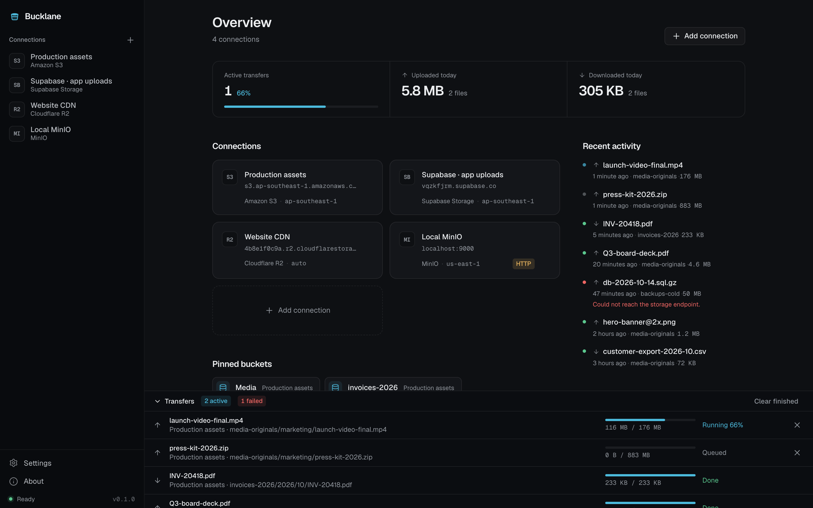
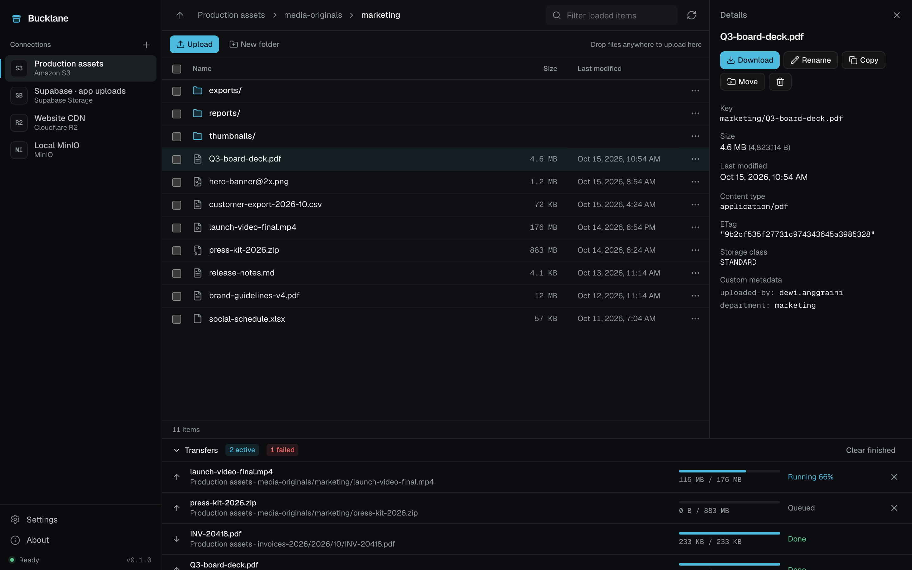
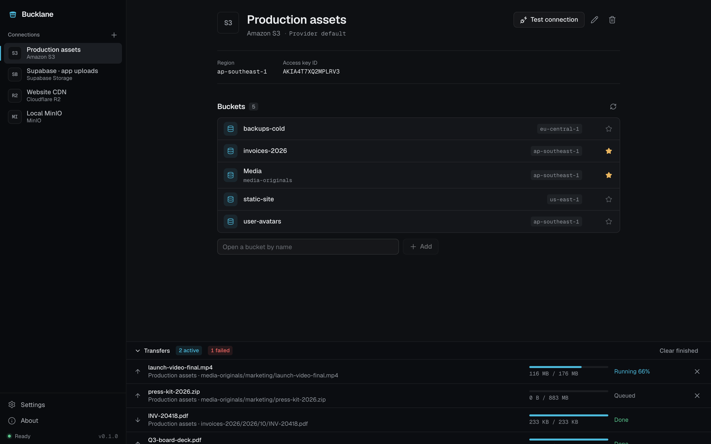
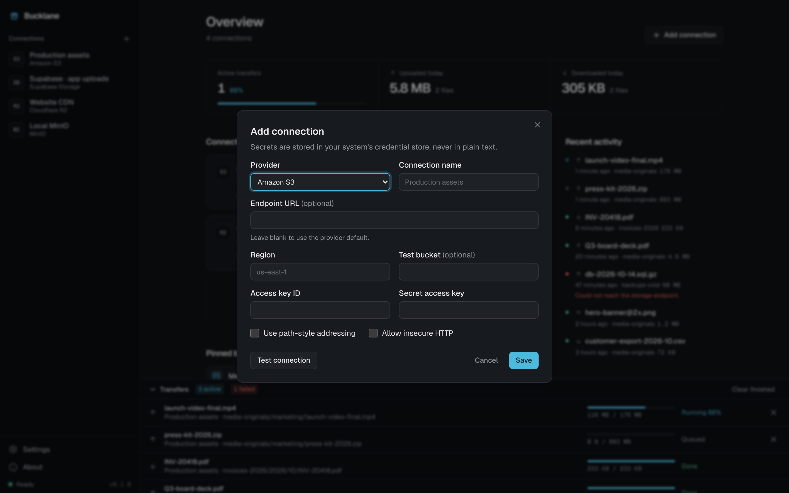
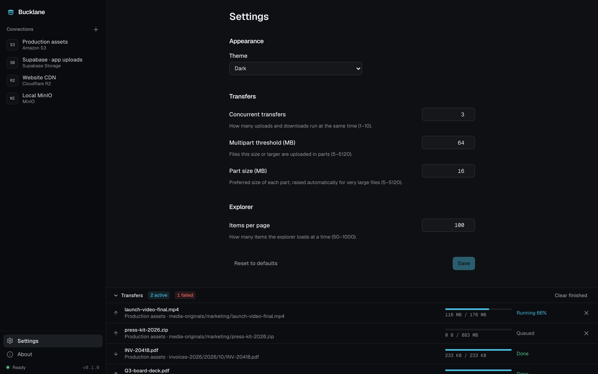
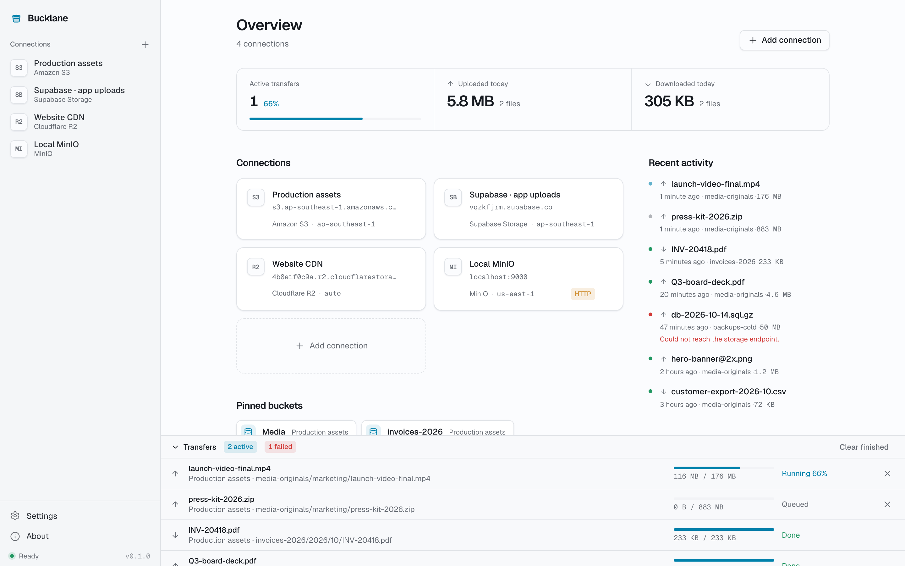

# Bucklane

**A desktop app for managing Amazon S3 and any S3-compatible storage — one window for all your buckets.**

Bucklane lets you browse buckets like folders, upload and download files, and move, rename, or delete objects without touching the command line. It works with Amazon S3, Supabase Storage, MinIO, Cloudflare R2, Wasabi, DigitalOcean Spaces, and any custom S3-compatible endpoint.

It is **local-first**: there is no Bucklane account and no server in between. The app talks to your storage provider directly, and your secret keys stay in your operating system's keychain.

Available for **macOS** (Apple Silicon and Intel), **Windows**, and **Linux**.



---

## Contents

- [Features](#features)
- [Screenshots](#screenshots)
- [Download and install](#download-and-install)
- [Getting started](#getting-started)
- [Connecting to each provider](#connecting-to-each-provider)
- [Using Bucklane](#using-bucklane)
- [Settings](#settings)
- [Privacy and security](#privacy-and-security)
- [Troubleshooting](#troubleshooting)
- [Current limitations](#current-limitations)
- [For developers](#for-developers)

---

## Features

|                                           |                                                                                                                                                                              |
| ----------------------------------------- | ---------------------------------------------------------------------------------------------------------------------------------------------------------------------------- |
| **Every S3-compatible provider**          | Amazon S3, Supabase Storage, MinIO, Cloudflare R2, Wasabi, DigitalOcean Spaces, or a custom endpoint. Save as many connections as you need.                                  |
| **Browse buckets like folders**           | Open folders, go back with the breadcrumb, load large buckets page by page, filter what's loaded, and view any object's size, type, ETag, and metadata.                      |
| **Upload and download in the background** | Every transfer joins a queue with live progress. Cancel or retry at any time. Large files are sent in parallel parts and streamed from disk, so they never fill your memory. |
| **Drag and drop**                         | Drop files from your desktop or Finder/Explorer into a folder to upload them, or drag files onto another folder to move them inside the bucket.                              |
| **Safe file operations**                  | Rename, copy, and move files. A move deletes the original only after the copy is verified. Replacing an existing file always asks first.                                     |
| **Folder delete you can trust**           | Before deleting a folder, Bucklane counts exactly how many objects and bytes will be removed and deletes only those.                                                         |
| **Bookmarks and pinned buckets**          | Open a bucket by name even when your keys can't list buckets, and star the ones you use most so they appear on the Overview.                                                 |
| **Overview dashboard**                    | See active transfers, what you uploaded and downloaded today, your connections, pinned buckets, and recent activity at a glance.                                             |
| **Light and dark mode**                   | Follows your system, or pick one in Settings.                                                                                                                                |

---

## Screenshots

<table>
  <tr>
    <td width="50%">
      
      <p align="center"><b>Explorer</b> — browse folders and inspect object details</p>
    </td>
    <td width="50%">
      
      <p align="center"><b>Connection</b> — buckets, regions, and bookmarks</p>
    </td>
  </tr>
  <tr>
    <td width="50%">
      
      <p align="center"><b>Add connection</b> — test before you save</p>
    </td>
    <td width="50%">
      
      <p align="center"><b>Settings</b> — theme and transfer tuning</p>
    </td>
  </tr>
  <tr>
    <td colspan="2">
      
      <p align="center"><b>Light mode</b> — follows your system or your choice in Settings</p>
    </td>
  </tr>
</table>

---

## Download and install

All installers are on the **[Releases page](https://github.com/okriiza/Bucklane/releases)**. Open the newest release and download the file for your system from the **Assets** list.

| Your computer                            | File to download                    |
| ---------------------------------------- | ----------------------------------- |
| Mac with Apple Silicon (M1, M2, M3, M4…) | `Bucklane_<version>_aarch64.dmg`    |
| Mac with an Intel processor              | `Bucklane_<version>_x64.dmg`        |
| Windows 10 or 11 (64-bit)                | `Bucklane_<version>_x64-setup.exe`  |
| Ubuntu, Debian, Linux Mint               | `Bucklane_<version>_amd64.deb`      |
| Fedora, openSUSE                         | `Bucklane-<version>-1.x86_64.rpm`   |
| Any other Linux                          | `Bucklane_<version>_amd64.AppImage` |

> Not sure which Mac you have? Open the **Apple menu → About This Mac**. "Chip: Apple M…" means Apple Silicon; "Processor: Intel…" means Intel.

> The current builds are **not code-signed yet**, so your system shows a warning the first time you open Bucklane. The steps below include how to get past it.

### macOS

1. Open the downloaded `.dmg`.
2. Drag **Bucklane** into the **Applications** folder.
3. Open Bucklane from Applications or Launchpad.
4. If macOS says the app **"is damaged and can't be opened"** or is from an **unidentified developer**, open **Terminal** and run:
   ```bash
   xattr -cr /Applications/Bucklane.app
   ```
   Then open Bucklane again. You only need to do this once per installed version.
5. The first time you save a connection, macOS may ask whether Bucklane can use your keychain. Choose **Always Allow** so it doesn't ask again.

### Windows

1. Run the downloaded `Bucklane_<version>_x64-setup.exe`.
2. If **Windows protected your PC** (SmartScreen) appears, click **More info → Run anyway**.
3. Follow the installer. Bucklane is added to the Start menu.

Prefer an MSI package (for example, for managed deployment)? Use `Bucklane_<version>_x64_en-US.msi` instead.

### Linux

First make sure a **Secret Service** keyring is available — Bucklane stores secret keys there and can't save connections without it. GNOME-based desktops include **GNOME Keyring**; KDE uses **KWallet**.

**Debian / Ubuntu / Linux Mint**

```bash
sudo apt install ./Bucklane_<version>_amd64.deb
```

**Fedora / openSUSE**

```bash
sudo dnf install ./Bucklane-<version>-1.x86_64.rpm
```

**AppImage (any distribution)**

```bash
chmod +x Bucklane_<version>_amd64.AppImage
./Bucklane_<version>_amd64.AppImage
```

### Updating

Download the newer installer from the Releases page and install it over the existing app. Your connections, bookmarks, settings, and transfer history are kept.

### Uninstalling

- **macOS:** drag Bucklane from Applications to the Trash.
- **Windows:** _Settings → Apps → Installed apps → Bucklane → Uninstall_.
- **Linux:** `sudo apt remove bucklane`, `sudo dnf remove bucklane`, or delete the AppImage.

Uninstalling leaves your local data and keychain entries in place. To remove secrets, delete your connections in Bucklane before uninstalling.

---

## Getting started

1. Open Bucklane and click **Add connection**.
2. Choose your **provider**. Bucklane fills in sensible defaults for it.
3. Enter a **connection name**, the **endpoint** (if your provider needs one), the **region**, your **access key ID**, and your **secret access key**.
4. Click **Test connection**. Bucklane checks that it can reach the storage and that your keys work.
   - If your keys aren't allowed to list all buckets, type a bucket name into **Test bucket** and test again.
5. Click **Save**. The connection appears in the sidebar.
6. Click the connection, then click a bucket to start browsing.

> Your secret access key is saved to the system keychain, never to a file. When editing a connection later, leave the secret field empty to keep the current one.

---

## Connecting to each provider

| Provider                 | Endpoint                                           | Region                                  | Notes                                                                             |
| ------------------------ | -------------------------------------------------- | --------------------------------------- | --------------------------------------------------------------------------------- |
| **Amazon S3**            | Leave empty                                        | Your main region, e.g. `ap-southeast-1` | Buckets in other regions are detected and opened automatically.                   |
| **Supabase Storage**     | `https://<project-ref>.supabase.co/storage/v1/s3`  | Your project's region                   | Use S3 access keys from your Supabase project's Storage settings (S3 connection). |
| **MinIO**                | Your server, e.g. `https://minio.example.com:9000` | `us-east-1` (default)                   | For a local `http://` server, tick **Allow insecure HTTP**.                       |
| **Cloudflare R2**        | `https://<account-id>.r2.cloudflarestorage.com`    | `auto`                                  | Use an R2 API token's access key ID and secret.                                   |
| **Wasabi**               | Leave empty (derived from the region)              | e.g. `us-east-1`, `eu-central-1`        |                                                                                   |
| **DigitalOcean Spaces**  | Leave empty (derived from the region)              | Your datacenter, e.g. `sgp1`, `nyc3`    |                                                                                   |
| **Custom S3-compatible** | Your endpoint URL                                  | As your provider documents              | Tick **Use path-style addressing** if your provider requires it.                  |

**HTTPS is the default.** Plain `http://` endpoints are rejected unless you explicitly tick **Allow insecure HTTP** — use that only for local or trusted networks.

---

## Using Bucklane

### Browsing

- Click a **connection** in the sidebar to see its buckets, then click a **bucket** to open it.
- Click a **folder** to open it. Use the **breadcrumb** or the **↑** button to go back up.
- Click a **file** to see its details: size, content type, last modified, ETag, storage class, and custom metadata.
- Large folders load 100 items at a time (adjustable in Settings) — click **Load more** at the bottom for the next page.
- The **filter** box searches the items already loaded in the current folder.

### Uploading

- Click **Upload** and choose one or more files, **or**
- Drag files from your desktop and drop them anywhere on the window while a folder is open.

Files go into the folder you're viewing. Progress appears in the **Transfers** panel at the bottom.

### Downloading

- Open the **⋯** menu on a file and choose **Download**, or click the file and use **Download** in the details panel.
- To download several files, tick their checkboxes and click **Download** in the selection bar.

You'll be asked where to save. A download is written to a temporary file first and only appears under its real name once it's complete.

### When a file already exists

If a file with the same name already exists at the destination, Bucklane asks what to do:

- **Skip** — leave the existing file alone.
- **Keep both** — save the new one as `name (1).ext`.
- **Replace** — overwrite the existing file.

Nothing is ever overwritten without your confirmation.

### Renaming, copying, and moving

- Open the **⋯** menu on a file and choose **Rename**, **Copy**, or **Move**. You can also press **F2** to rename.
- To move files into a folder, **drag** them onto that folder or onto a folder in the breadcrumb. Tick several files first to move them together.

### Creating folders

Click **New folder** in the toolbar.

### Deleting

- Tick one or more files or folders and click **Delete**, or use the **⋯** menu, or press the **Delete** key.
- For folders, Bucklane first counts everything inside and shows you the number of objects and total size before you confirm.
- If some objects can't be deleted (for example, because of permissions), Bucklane lists exactly which ones failed.

### Bookmarks and pinned buckets

- If your keys can't list buckets, type a bucket name into **Open a bucket by name** on the connection page.
- Click the **☆** next to any bucket to bookmark it. Bookmarked buckets also appear under **Pinned buckets** on the Overview.

### Transfers

The **Transfers** panel shows every upload and download with its progress and status. You can **cancel** a running or queued transfer, **retry** a failed one, and **clear finished** ones from the list. The panel opens on its own when a transfer starts and tucks itself away when everything finishes successfully.

### Keyboard shortcuts

| Key      | Action                                          |
| -------- | ----------------------------------------------- |
| `Enter`  | Open a folder, or show a file's details         |
| `F2`     | Rename the focused file                         |
| `Delete` | Delete the focused item (asks for confirmation) |
| `Esc`    | Cancel a drag in progress                       |

---

## Settings

Open **Settings** in the sidebar.

| Setting              | Default      | What it does                                                              |
| -------------------- | ------------ | ------------------------------------------------------------------------- |
| Theme                | Match system | Light, dark, or follow your system.                                       |
| Concurrent transfers | 3            | How many uploads and downloads run at the same time (1–10).               |
| Multipart threshold  | 64 MB        | Files this size or larger are uploaded in parts (5–5120 MB).              |
| Part size            | 16 MB        | Size of each part; raised automatically for very large files (5–5120 MB). |
| Items per page       | 100          | How many items the explorer loads at a time (50–1000).                    |

**Reset to defaults** restores all settings without affecting your connections.

---

## Privacy and security

**Stored on your computer:**

- Connection settings and access key IDs
- Bucket bookmarks
- Transfer history (until you clear it)
- Your preferences
- Diagnostic logs for the last 7 days, without secrets

**Never stored in a file or sent anywhere else:**

- Your secret access keys — they live only in the system keychain (macOS Keychain, Windows Credential Manager, or Linux Secret Service)
- Your files, except where you choose to upload or download them
- Usage data or crash reports — Bucklane has no telemetry

Deleting a connection removes its secret from the keychain. Buckets and files on your storage provider are never affected by removing a connection.

---

## Troubleshooting

| Message or problem                                                            | What to do                                                                                                                        |
| ----------------------------------------------------------------------------- | --------------------------------------------------------------------------------------------------------------------------------- |
| _"The access key ID or secret access key is incorrect."_                      | Re-enter the keys. Edit the connection and paste the secret again.                                                                |
| _"The credentials were accepted but cannot list buckets."_                    | Your keys work but aren't allowed to list buckets. Add the bucket by name on the connection page, or enter it as **Test bucket**. |
| _"The region or endpoint does not match this storage account."_               | Check the region and endpoint for your provider (see the table above).                                                            |
| _"HTTP endpoints are insecure…"_                                              | Use an `https://` endpoint, or tick **Allow insecure HTTP** for a local server.                                                   |
| _"Could not reach the storage endpoint."_                                     | Check your internet connection, VPN, firewall, and the endpoint URL.                                                              |
| _"The system credential store is unavailable."_ (Linux)                       | Install and unlock GNOME Keyring or KWallet, then try again.                                                                      |
| A transfer failed with _"Bucklane was closed before this transfer finished."_ | The app was closed while it was running. Click **retry** to start it again.                                                       |
| macOS says the app "is damaged"                                               | See the [macOS install steps](#macos).                                                                                            |

---

## Current limitations

- Folders can't be uploaded, downloaded, renamed, copied, or moved yet — work with the files inside them instead. (Deleting folders is supported.)
- Copying, moving, or renaming objects larger than **5 GB** isn't supported yet.
- A single folder delete is limited to **100,000** objects.
- Transfers don't resume after the app is closed; they're marked as failed and can be retried from the start.
- Installers aren't code-signed yet (see [Download and install](#download-and-install)).
- The interface is in English.

---

## For developers

Product and technical design: [docs/prd.md](docs/prd.md), [docs/tsd.md](docs/tsd.md), and [docs/database_design.md](docs/database_design.md).

### Prerequisites

- Node.js 22+ and pnpm
- Rust (stable, via rustup)
- Platform dependencies from the [Tauri prerequisites guide](https://v2.tauri.app/start/prerequisites/)
- Linux: a Secret Service provider (GNOME Keyring or KWallet)

### Run the app

```bash
pnpm install
pnpm tauri dev
```

TypeScript IPC bindings (`src/services/tauri/bindings.ts`) are generated from Rust on every debug run and by `cargo test`. Commit the regenerated file; CI fails if it is out of date.

### Checks

```bash
pnpm lint && pnpm format:check && pnpm typecheck && pnpm test && pnpm build
cd src-tauri && cargo fmt --check && cargo clippy --all-targets -- -D warnings && cargo test
```

### S3 integration tests

The Rust suite includes tests against a real S3-compatible server. They're skipped unless `BUCKLANE_S3_TEST_ENDPOINT` is set:

```bash
docker compose up -d s3
BUCKLANE_S3_TEST_ENDPOINT=http://localhost:9100 cargo test --manifest-path src-tauri/Cargo.toml
docker compose down
```

### Updating the screenshots

The images in `docs/screenshots/` are generated from the running dev server in a demo mode with sample data (`?demo`, development builds only). With a Chromium-based browser installed (Chrome, Chromium, Edge, or Brave):

```bash
pnpm dev            # in one terminal
pnpm screenshots    # in another
```

Set `CHROME_PATH` if the browser isn't found automatically. Shots and their sample data live in `scripts/screenshots.mjs` and `src/demo/demoIpc.ts`.

### Releasing

Push a version tag (for example `v0.1.0`) to build macOS, Windows, and Linux installers into a draft GitHub release. See [docs/releasing.md](docs/releasing.md).
