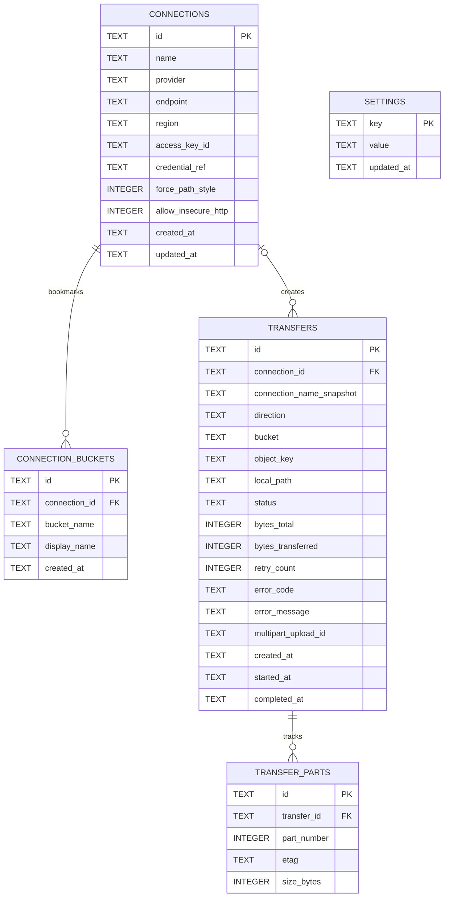

# Bucklane — Database Design v1.0

> **Document ID:** BUCK-DBD-001  
> **Version:** 1.0  
> **Status:** Draft for Implementation  
> **Date:** 2026-10-14  
> **Product:** Bucklane — Desktop S3 Storage Manager  
> **Related:** [PRD v1.0](prd.md), [TSD v1.0](tsd.md)

## 1. Overview

Bucklane uses **SQLite** as its local database for application metadata. It does **not** store remote S3 object contents. S3 files remain on their providers unless users explicitly download them.

Persistent secrets (such as S3 secret access keys) are stored in the operating system's secure credential store. SQLite stores only a `credential_ref` that points to the secret, plus non-secret connection details.

### 1.1 Goals

- Manage unlimited locally saved S3-compatible connections, subject to device resources.
- Support explicitly configured buckets when `ListBuckets` permission is unavailable.
- Persist transfer history and multipart upload bookkeeping.
- Store user preferences locally.
- Preserve data integrity through migrations, foreign keys, constraints, and indexes.

### 1.2 Database conventions

| Concern           | Standard                                                |
| ----------------- | ------------------------------------------------------- |
| Database          | SQLite                                                  |
| Rust access layer | SQLx                                                    |
| Primary key       | UUID v7 stored as `TEXT`                                |
| Timestamps        | UTC RFC 3339 / ISO 8601 strings                         |
| Boolean           | `INTEGER` with `CHECK (value IN (0, 1))`                |
| Schema management | Versioned SQLx migrations                               |
| Foreign keys      | `PRAGMA foreign_keys = ON` on **every connection**      |
| Journal mode      | `PRAGMA journal_mode = WAL`                             |
| Busy timeout      | `PRAGMA busy_timeout = 5000`                            |
| Secrets           | Native OS Keychain / credential store, **never SQLite** |
| Naming            | `snake_case` table and column names                     |

> `PRAGMA journal_mode = WAL` and `PRAGMA busy_timeout = 5000` are **database runtime configuration**, not part of the schema migration. Foreign keys must also be enabled on each SQLite connection; executing that pragma once inside the migration is insufficient.

## 2. Entity Relationship Diagram



## 3. Table Specifications

### 3.1 `connections`

Stores user-defined connection profiles. The `credential_ref` is an opaque key identifying the corresponding entry in the OS credential store.

| Column                | Type    | Constraints                | Description                                                     |
| --------------------- | ------- | -------------------------- | --------------------------------------------------------------- |
| `id`                  | TEXT    | PK                         | Connection UUID v7                                              |
| `name`                | TEXT    | NOT NULL                   | Friendly display name                                           |
| `provider`            | TEXT    | NOT NULL, CHECK            | `aws`, `supabase`, `minio`, `cloudflare_r2`, `wasabi`, `digitalocean_spaces`, `custom` |
| `endpoint`            | TEXT    | NULL                       | Custom S3 endpoint; optional for AWS                            |
| `region`              | TEXT    | NOT NULL                   | Provider region or signing region                               |
| `access_key_id`       | TEXT    | NOT NULL                   | Access key identifier, not secret key                           |
| `credential_ref`      | TEXT    | NOT NULL, UNIQUE           | OS credential-store reference                                   |
| `force_path_style`    | INTEGER | NOT NULL, DEFAULT 0, CHECK | Path-style addressing                                           |
| `allow_insecure_http` | INTEGER | NOT NULL, DEFAULT 0, CHECK | Explicit exception for HTTP endpoints                           |
| `created_at`          | TEXT    | NOT NULL                   | Created timestamp                                               |
| `updated_at`          | TEXT    | NOT NULL                   | Last updated timestamp                                          |

**Rules:**

- Never store `secret_access_key`, session token, authorization header, or presigned URL in this table.
- Connection configuration validation is enforced by the application service, including URL scheme and region.
- Each connection owns exactly one `credential_ref` (1:1); credentials are never shared between connections, so deleting a connection always deletes its secret.
- Renaming a connection does not rotate credentials.
- Credential rotation requires coordinated updates to SQLite and the OS credential store; those systems do not share an atomic transaction.

### 3.2 `connection_buckets`

Stores bookmarked bucket names that users can navigate directly, including with credentials that lack `ListBuckets` permission.

| Column          | Type | Constraints  | Description            |
| --------------- | ---- | ------------ | ---------------------- |
| `id`            | TEXT | PK           | Bookmark UUID v7       |
| `connection_id` | TEXT | NOT NULL, FK | Parent connection      |
| `bucket_name`   | TEXT | NOT NULL     | Exact bucket name      |
| `display_name`  | TEXT | NULL         | Optional display label |
| `created_at`    | TEXT | NOT NULL     | Created timestamp      |

**Rules:** `UNIQUE(connection_id, bucket_name)`; delete bookmarks when the connection is deleted. A bookmarked bucket is not evidence that the remote bucket currently exists or is accessible.

### 3.3 `transfers`

Stores local transfer history and durable operational metadata. Runtime progress may be buffered and flushed periodically rather than writing to SQLite on every byte or progress event.

| Column                     | Type    | Constraints         | Description                                            |
| -------------------------- | ------- | ------------------- | ------------------------------------------------------ |
| `id`                       | TEXT    | PK                  | Transfer UUID v7                                       |
| `connection_id`            | TEXT    | NULL, FK            | Source connection; nullable for deleted connections    |
| `connection_name_snapshot` | TEXT    | NOT NULL            | Human-readable name at transfer time                   |
| `direction`                | TEXT    | NOT NULL, CHECK     | `UPLOAD` or `DOWNLOAD`                                 |
| `bucket`                   | TEXT    | NOT NULL            | Target/source bucket                                   |
| `object_key`               | TEXT    | NOT NULL            | Exact S3 object key                                    |
| `local_path`               | TEXT    | NOT NULL            | Local file path; treat as privacy-sensitive            |
| `bytes_total`              | INTEGER | NULL, CHECK >= 0    | Expected bytes if known                                |
| `bytes_transferred`        | INTEGER | NOT NULL, DEFAULT 0 | Observed transferred bytes                             |
| `status`                   | TEXT    | NOT NULL, CHECK     | `QUEUED`, `RUNNING`, `COMPLETED`, `FAILED`, `CANCELED` |
| `retry_count`              | INTEGER | NOT NULL, DEFAULT 0 | Retry attempts                                         |
| `error_code`               | TEXT    | NULL                | Sanitized machine-readable error code                  |
| `error_message`            | TEXT    | NULL                | Sanitized diagnostic message                           |
| `multipart_upload_id`      | TEXT    | NULL                | Remote multipart upload ID for recovery/cleanup        |
| `overwrite`                | INTEGER | NOT NULL, DEFAULT 0 | User chose to replace an existing destination (0/1)    |
| `created_at`               | TEXT    | NOT NULL            | Queued timestamp                                       |
| `started_at`               | TEXT    | NULL                | Start timestamp                                        |
| `completed_at`             | TEXT    | NULL                | Terminal-state timestamp                               |

**Rules:**

- `connection_id` uses `ON DELETE SET NULL` to retain transfer history after connection deletion.
- Existing active transfers must be canceled or safely stopped before a connection is removed.
- On application restart, stale `RUNNING` transfers must be reconciled (e.g. `FAILED` with error `INTERRUPTED`) unless an explicitly supported resume procedure takes ownership.
- A persisted multipart upload ID **does not** imply that uploads can resume across application restarts in MVP.
- Protect local paths and object names in diagnostics and exported support bundles.

### 3.4 `transfer_parts`

Tracks completed multipart upload parts for cleanup, inspection, and potential future resume support.

| Column        | Type    | Constraints    | Description                 |
| ------------- | ------- | -------------- | --------------------------- |
| `id`          | TEXT    | PK             | Part record UUID v7         |
| `transfer_id` | TEXT    | NOT NULL, FK   | Related transfer            |
| `part_number` | INTEGER | NOT NULL, > 0  | S3 part number              |
| `etag`        | TEXT    | NOT NULL       | Provider-returned part ETag |
| `size_bytes`  | INTEGER | NOT NULL, >= 0 | Uploaded part size          |

**Rules:** `UNIQUE(transfer_id, part_number)` and `ON DELETE CASCADE`. For production use, multipart completion must use the correct ordered part identifiers. Do not treat ETags as universally valid MD5 checksums.

### 3.5 `settings`

Stores a typed set of application preferences using JSON-encoded values.

| Column       | Type | Constraints | Description            |
| ------------ | ---- | ----------- | ---------------------- |
| `key`        | TEXT | PK          | Known setting name     |
| `value`      | TEXT | NOT NULL    | JSON-encoded value     |
| `updated_at` | TEXT | NOT NULL    | Last updated timestamp |

**Rules:** validate each value in SettingsService; do not write credentials or arbitrary application objects here.

## 4. Initial Migration

**Location:** `src-tauri/migrations/202610140001_initial_schema.sql`

```sql
CREATE TABLE connections (
    id TEXT PRIMARY KEY,
    name TEXT NOT NULL,
    provider TEXT NOT NULL CHECK (provider IN (
        'aws', 'supabase', 'minio', 'cloudflare_r2', 'wasabi',
        'digitalocean_spaces', 'custom'
    )),
    endpoint TEXT,
    region TEXT NOT NULL,
    access_key_id TEXT NOT NULL,
    credential_ref TEXT NOT NULL UNIQUE,
    force_path_style INTEGER NOT NULL DEFAULT 0
        CHECK (force_path_style IN (0, 1)),
    allow_insecure_http INTEGER NOT NULL DEFAULT 0
        CHECK (allow_insecure_http IN (0, 1)),
    created_at TEXT NOT NULL,
    updated_at TEXT NOT NULL
);

CREATE INDEX idx_connections_name
    ON connections(name COLLATE NOCASE);

CREATE TABLE connection_buckets (
    id TEXT PRIMARY KEY,
    connection_id TEXT NOT NULL,
    bucket_name TEXT NOT NULL,
    display_name TEXT,
    created_at TEXT NOT NULL,
    UNIQUE(connection_id, bucket_name),
    FOREIGN KEY (connection_id)
        REFERENCES connections(id)
        ON DELETE CASCADE
);

CREATE TABLE transfers (
    id TEXT PRIMARY KEY,
    connection_id TEXT,
    connection_name_snapshot TEXT NOT NULL,
    direction TEXT NOT NULL
        CHECK (direction IN ('UPLOAD', 'DOWNLOAD')),
    bucket TEXT NOT NULL,
    object_key TEXT NOT NULL,
    local_path TEXT NOT NULL,
    bytes_total INTEGER
        CHECK (bytes_total IS NULL OR bytes_total >= 0),
    bytes_transferred INTEGER NOT NULL DEFAULT 0
        CHECK (bytes_transferred >= 0),
    status TEXT NOT NULL DEFAULT 'QUEUED'
        CHECK (status IN (
            'QUEUED', 'RUNNING', 'COMPLETED', 'FAILED', 'CANCELED'
        )),
    retry_count INTEGER NOT NULL DEFAULT 0
        CHECK (retry_count >= 0),
    error_code TEXT,
    error_message TEXT,
    multipart_upload_id TEXT,
    created_at TEXT NOT NULL,
    started_at TEXT,
    completed_at TEXT,
    FOREIGN KEY (connection_id)
        REFERENCES connections(id)
        ON DELETE SET NULL
);

CREATE INDEX idx_transfers_status_created
    ON transfers(status, created_at DESC);

CREATE INDEX idx_transfers_connection
    ON transfers(connection_id);

CREATE TABLE transfer_parts (
    id TEXT PRIMARY KEY,
    transfer_id TEXT NOT NULL,
    part_number INTEGER NOT NULL CHECK (part_number > 0),
    etag TEXT NOT NULL,
    size_bytes INTEGER NOT NULL CHECK (size_bytes >= 0),
    UNIQUE(transfer_id, part_number),
    FOREIGN KEY (transfer_id)
        REFERENCES transfers(id)
        ON DELETE CASCADE
);

CREATE TABLE settings (
    key TEXT PRIMARY KEY,
    value TEXT NOT NULL,
    updated_at TEXT NOT NULL
);
```

### 4.1 SQLx startup behavior

At application startup:

1. Locate/create the application's private data directory.
2. Open the SQLite pool with `create_if_missing(true)` and appropriate connection limits.
3. Apply foreign-key and busy-timeout settings to **every** SQLite connection.
4. Enable WAL mode at database initialization.
5. Run embedded versioned migrations using SQLx.
6. If a migration fails, do not continue to features requiring database access; present a sanitized startup error.

> Do not place SQLx runtime pool configuration inside the migration file. The SQL schema must remain portable and testable with SQLite itself.

### 4.2 Subsequent migrations

| File | Change |
| --- | --- |
| `202610150001_transfer_overwrite.sql` | Adds `transfers.overwrite` so the user's conflict decision is honored at download finalization and on retry. |

## 5. Default Settings

The following keys are seeded by the application settings service (or an explicit seed routine), **not** hardcoded into the schema migration:

```json
{
  "appearance.theme": "system",
  "appearance.language": "en",
  "transfers.max_concurrent": 3,
  "transfers.multipart_threshold_mb": 64,
  "transfers.multipart_part_size_mb": 16,
  "transfers.max_retries": 3,
  "transfers.progress_interval_ms": 300,
  "explorer.page_size": 100,
  "explorer.confirm_delete": true,
  "explorer.confirm_overwrite": true,
  "logging.level": "info"
}
```

These are initial development defaults, **not benchmarked performance targets**. Multipart sizing must be validated against the target provider's API limits.

## 6. Data Lifecycle

### 6.1 Create connection

1. Validate provider settings and key identifier.
2. Create a new unique `credential_ref`.
3. Write the secret to the secure OS credential store.
4. Insert connection metadata in SQLite.
5. If the SQLite insert fails, delete the newly stored credential as a compensating action.
6. If compensation fails, record a sanitized recovery condition; never log the secret.

Because SQLite and the OS credential store are separate systems, this is **not** a single atomic transaction.

### 6.2 Rotate credential

1. Store the replacement secret under a new reference.
2. Update `connections.credential_ref` in SQLite.
3. Invalidate the old in-memory S3 client.
4. Remove the old secret after the database update succeeds.
5. Recover safely from partial failure without exposing credentials.

### 6.3 Delete connection

1. Check and stop active transfers using the connection.
2. Delete connection metadata and cascaded bookmarks in SQLite.
3. Preserve transfer history using `connection_name_snapshot` and nullable `connection_id`.
4. Remove the no-longer-referenced secret from the OS credential store.
5. Surface a cleanup warning if secret deletion fails.

### 6.4 Restart recovery

1. Load non-terminal transfers from SQLite.
2. Reconcile stale `QUEUED` and `RUNNING` state to `FAILED / INTERRUPTED` for MVP; nothing restarts without user action.
3. Identify orphaned multipart uploads for best-effort cleanup.
4. Never automatically overwrite local or remote files on recovery.

### 6.5 Retention

- Connection metadata: until user deletes the connection.
- Transfer history: retained until manually cleared or a future user-configurable retention policy applies. Clearing deletes only terminal-state rows (`COMPLETED`, `FAILED`, `CANCELED`) and skips rows whose `multipart_upload_id` has not been cleaned up.
- Retrying a failed multipart upload resets the same row to `QUEUED`, increments `retry_count`, clears `multipart_upload_id` after a best-effort abort, and deletes its `transfer_parts`.
- Multipart metadata: retain while necessary for cleanup and delete after successful completion/abort and record reconciliation.
- Temporary downloads: controlled by the transfer engine, not SQLite.

## 7. Indexing & Query Patterns

| Use case                    | Query/index strategy                                                                   |
| --------------------------- | -------------------------------------------------------------------------------------- |
| Find connections by name    | `idx_connections_name`                                                                 |
| Fetch bucket bookmarks      | Unique index on `(connection_id, bucket_name)` also supports the leading connection ID |
| Recent transfers by status  | `idx_transfers_status_created`                                                         |
| Connection transfer history | `idx_transfers_connection`                                                             |
| Multipart parts in order    | Unique index on `(transfer_id, part_number)`                                           |
| Settings lookup             | Primary key on `settings.key`                                                          |

Avoid storing object listings as a local authoritative cache in MVP. Listings are fetched from the remote provider with pagination; frontend caching, if added, is ephemeral and refreshable.

## 8. Validation & Integrity Requirements

- Validate provider name, endpoint scheme, region, names, and bucket identifiers at the service boundary.
- Treat S3 object keys as opaque remote identifiers, never as trusted local filesystem paths.
- Use parameterized SQL queries for all repository operations.
- Keep timestamps normalized to UTC.
- Ensure `bytes_transferred` never becomes negative; monotonic progress is enforced by TransferService.
- All file overwrite/delete decisions must be made in application services; database constraints alone cannot protect remote objects.
- Implement migration tests against fresh databases and upgrade tests from the prior version when a later version is introduced.

## 9. Security & Privacy

- `access_key_id` is an identifier but may still be sensitive operational metadata; do not casually include it in diagnostics.
- `credential_ref` must not contain the secret itself.
- OS credential storage must not silently fall back to plaintext when unavailable.
- No auth tokens, presigned URLs, secret access keys, or request signature material in SQLite or logs.
- Use least-privilege file permissions for the local database where supported.
- Backup/export should exclude keychain secrets unless a separately designed secure export flow is implemented.
- Treat `local_path`, object keys, and endpoint hostnames as potentially sensitive in support exports.

## 10. Test Plan

| Test ID | Scenario                                 | Expected result                                               |
| ------- | ---------------------------------------- | ------------------------------------------------------------- |
| DB-001  | Fresh application startup                | DB created, all migrations applied                            |
| DB-002  | Repeated startup                         | No duplicate tables or records from migrations                |
| DB-003  | Invalid provider value                   | SQLite rejects row                                            |
| DB-004  | Duplicate bucket bookmark per connection | Unique constraint blocks duplicate                            |
| DB-005  | Delete connection with bookmarks         | Bookmarks cascade-delete                                      |
| DB-006  | Delete connection with history           | Transfer history preserved, `connection_id = NULL`            |
| DB-007  | Delete transfer                          | Associated `transfer_parts` cascade-delete                    |
| DB-008  | Store credential                         | Secret available from Keychain, absent from SQLite            |
| DB-009  | Credential rotation partial failure      | Existing usable credential retained or recoverable            |
| DB-010  | Restart during `RUNNING` transfer        | State reconciled safely                                       |
| DB-011  | Invalid negative byte counters           | SQLite rejects row                                            |
| DB-012  | Invalid settings value                   | SettingsService refuses update                                |
| DB-013  | Foreign key enforcement                  | Invalid references rejected on every pool connection          |
| DB-014  | Interrupted migration                    | Startup reports failure without silently using invalid schema |

## 11. Out of Scope (MVP)

- Full remote object index / search database.
- Storing file payloads locally in SQLite.
- Distributed transactions between SQLite and OS Keychain.
- Cross-device account sync.
- Automatic two-way file synchronization.
- Guaranteed multipart resume across application restart.
- Organization-level RBAC or central user management.
- S3 version history and lifecycle administration.

## 12. Future Database Extensions

Potential later tables or migrations:

- `connection_groups` — visually group connection profiles.
- `transfer_batches` — group folder or multi-file transfers.
- `local_sync_jobs` — persistent synchronization configuration.
- `provider_capabilities` — tested capability snapshots with expiry and permission context.
- `presigned_link_history` — **only if justified**, with strict expiry and security restrictions; never persist signed URLs by default.

## 13. Definition of Done

- [ ] Migration creates the expected schema on a fresh SQLite database.
- [ ] Foreign keys are enabled on all pooled connections.
- [ ] Connection create/edit/delete preserves local data integrity.
- [ ] OS Keychain secrets do not appear in SQLite, log output, or connection DTOs.
- [ ] Bookmark and transfer foreign-key behavior matches this design.
- [ ] Restart reconciliation is deterministic and tested.
- [ ] Critical queries use the intended indexes.
- [ ] Automated migration and repository tests pass.
- [ ] Documentation is versioned together with implementation changes.

---

**End of Database Design v1.0 — Bucklane**
